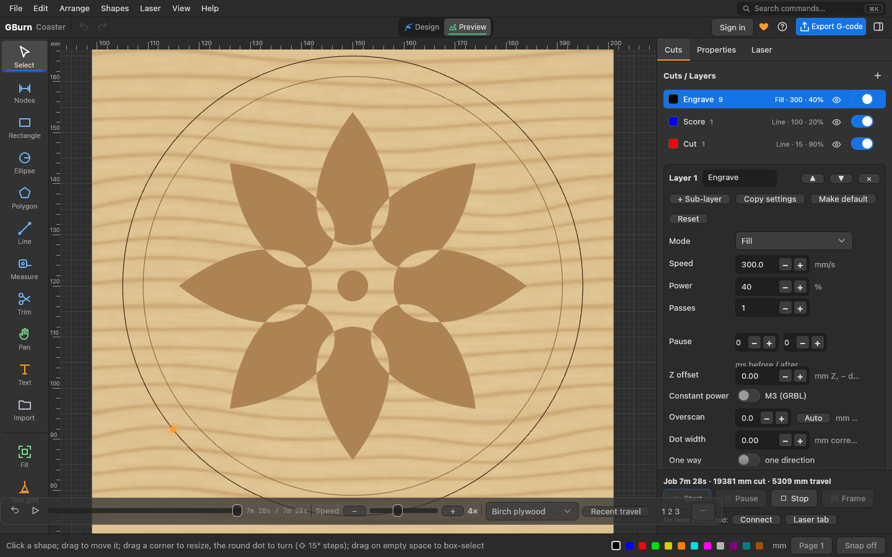

# GBurn

**Free laser design and control for Mac, Windows and Linux.** Draw or import a design, set cut and engrave settings per layer, preview the job, then frame and burn on your laser: GRBL diode lasers, Ruida CO2 lasers and EZCAD2 fibre galvo lasers.

[**Download**](https://github.com/fillinthe/gburn/releases/latest) · [Use it online](https://gburn.app/app/) · [Website](https://gburn.app) · [Docs](https://gburn.app/docs/) · [Support](https://gworkshop.app/support/) · [Donate](https://gburn.app/donate/)

## What it does

- **Design:** rectangles, ellipses, polygons and stars, lines and curves, text in any installed font (on a path, bent letters, single-line fonts), QR codes, Data Matrix and barcodes, a shapes library and your own art library.
- **Edit:** nodes, booleans, offset, weld, trim, round corners, bridges, warp and deform, arrays (grid, circular, along a path, virtual), align and distribute, nesting, pages.
- **Layers:** line, fill, fill + line, offset fill and image modes, with speed, power, passes, interval, angle, kerf, tabs, perforation, lead-ins, overscan, ramps and sub-layers. Material library and material, focus and interval tests.
- **Pictures:** dithering (Floyd–Steinberg, Jarvis, Stucki, Atkinson, halftone, newsprint, 3D slices and more), brightness / contrast / gamma, trace to vectors (outline or centerline), depth maps from STL / 3MF.
- **Preview:** the whole job in time order with a speed control, travel moves, time per layer, and how it will look on wood, acrylic, slate, leather or metal.
- **Lasers:** GRBL over USB or the network, Ruida over the network or USB, EZCAD2 (BJJCZ LMC) fibre galvos over USB with lens correction. Jog, frame, start, pause and stop; rotary; print and cut; camera overlay; variable text and serial numbers.
- **Files:** opens SVG, DXF, PDF, AI, EPS, HPGL, LightBurn projects (.lbrn2 / .lbrn) and pictures; exports G-code, Ruida .rd, SVG, DXF, PDF and LightBurn projects. Saves `.gburn`.

## Download

Get the file for your computer from the [latest release](../../releases/latest). Nothing to install on Windows and Linux: unpack and run.

| Your computer | File |
|---|---|
| macOS (Apple silicon and Intel) | `GBurn-0.2.0-macOS.dmg` |
| Windows 10 / 11 (64-bit) | `GBurn-0.2.0-Windows-x64.zip` |
| Linux x86_64 | `GBurn-0.2.0-Linux-x86_64.tar.gz` |
| Linux ARM64 (Raspberry Pi 4/5, ARM laptops) | `GBurn-0.2.0-Linux-aarch64.tar.gz` |
| GBurn Link for Mac (see below) | `GBurn-Link-0.2.0-macOS.zip` |

`SHA256SUMS.txt` in the release lists a checksum for every file: `shasum -a 256 -c SHA256SUMS.txt`.

### First start

- **macOS:** open the .dmg, drag GBurn to Applications. The app is not notarized by Apple yet, so the first time right-click it and choose **Open**.
- **Windows:** unzip, run `gburn.exe`. It is not code-signed yet, so SmartScreen may say "unknown publisher": **More info → Run anyway**.
- **Linux:** `tar xzf` the file, then run `./gburn` (or `./install.sh` to add it to your applications menu).

No account is needed on the desktop: designs are `.gburn` files on your computer. Signing in (free, the same G Workshop account as GCarve and GSketch) adds designs saved online.

### Your first job on a machine

Click **Frame** first: the head traces the job's outline with the beam off (or at the low frame power you set). Then run a small test at low power on scrap before a real job. Never leave a running laser.

### GBurn Link

A browser can't reach a Ruida laser on your network. GBurn Link is a small helper you run on the computer next to the laser; the online version at gburn.app talks to it. The Windows and Linux downloads include it (`gburn-link`); Mac users download `GBurn-Link-0.2.0-macOS.zip`. The desktop app doesn't need it.

### Fibre galvo lasers (EZCAD2)

The galvo uses the computer's USB directly. On Windows it needs the WinUSB driver (Zadig), which means EZCAD2 can't use the same PC at the same time; macOS needs nothing; Linux needs a udev rule. Use your machine's lens correction (.cor) file from the maker in Machine Settings.

## System requirements

- **macOS:** Apple silicon, or Intel with macOS 10.13 or newer.
- **Windows:** 10 or 11, 64-bit. No installer, no admin rights.
- **Linux:** x86-64 or ARM64, glibc 2.30 or newer (Debian 11, Ubuntu 20.04 and later).
- **All:** OpenGL 2.0 graphics.

## FAQ

**Is it really free?** Yes. The desktop apps are free with every tool. The online version needs a free account (3 cloud designs).

**Is it LightBurn?** No. GBurn is an independent app that works the way LightBurn users expect, and opens LightBurn projects. LightBurn Software has nothing to do with it.

**Does it work offline?** Yes.

## Help and feedback

- Questions, bugs and requests: [gworkshop.app/support](https://gworkshop.app/support/), or Help › Report a Bug in the app.
- Please attach the `.gburn` file that went wrong and say what you clicked.

## Licence

GBurn is free to use. The program and its files are © Fill in the Blank, all rights reserved; see [LICENSE.md](LICENSE.md), the [Terms](https://gworkshop.app/terms/) and [Privacy](https://gworkshop.app/privacy/) pages. This repository holds the downloads and release notes only; it is not the source code.

LightBurn is a trademark of LightBurn Software, LLC. GBurn is not affiliated with or endorsed by LightBurn Software.
